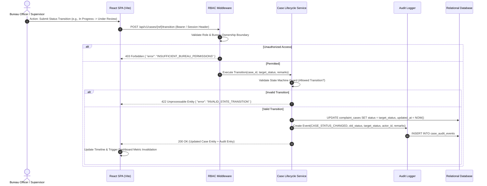
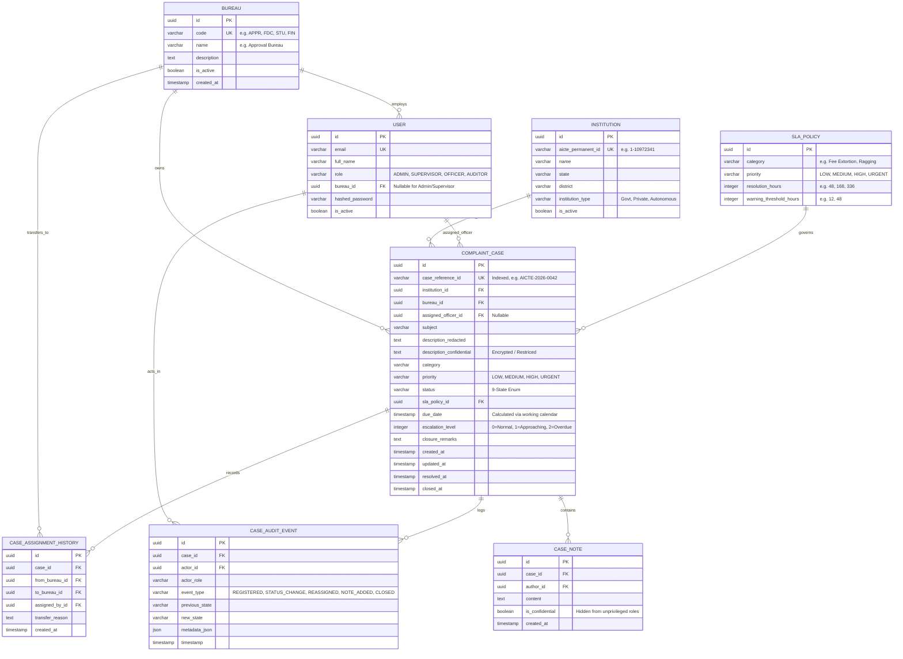

# System Architecture & Technical Specification
## AICTE Integrated Complaint Case Monitoring Dashboard

**Document Version:** 1.0.0  
**Status:** Approved Blueprint for Implementation  
**Target Environment:** Smart India Hackathon (SIH) Prototype & Production Foundation  

---

## 1. System Overview & Core Objectives

The **AICTE Integrated Complaint Case Monitoring Dashboard** is an enterprise-grade, role-based case management and oversight platform designed for authorized personnel across AICTE bureaus and cells. 

### Key Objectives
1. **Consolidated Visibility**: Real-time cross-bureau tracking of institution-related complaint cases, current ownership, status, and pending actions without manual coordination overhead.
2. **Deterministic Accountability & Auditability**: Enforce an explicit 9-stage lifecycle state machine with an append-only audit trail capturing every state change, reassignment, and internal note.
3. **Transparent SLA & Aging Risk Radar**: Dynamically calculate deadlines based on configurable working-day rules and severity policies, surfacing early warning signals before breaches occur.
4. **Explainable Intelligence**: Provide deterministic duplicate detection (TF-IDF cosine similarity) and smart routing recommendations with evidence breakdowns—subject to mandatory human confirmation.
5. **Zero Fabrication Policy**: Avoid inventing official statutory deadlines, confidential bureau hierarchies, or live government database credentials by structuring all institutional hierarchies and workflows to be fully configurable.

---

## 2. Architecture & Data-Flow Topology

The platform uses a **Modular Monolith** architecture with a clean boundary between the presentation layer, REST API gateway, domain lifecycle services, and relational persistence.

```
+-----------------------------------------------------------------------------------+
|                            PRESENTATION LAYER (REACT 18 + TS + VITE)              |
|  +---------------------+  +---------------------+  +---------------------------+  |
|  | Executive Dashboard |  | Case Register & Grid|  | Case Detail & Timeline    |  |
|  +---------------------+  +---------------------+  +---------------------------+  |
|  +---------------------+  +---------------------+  +---------------------------+  |
|  | SLA Risk Radar View |  | CSV Ingest & Preview|  | Demo Role-Switcher Widget |  |
|  +---------------------+  +---------------------+  +---------------------------+  |
+------------------------------------------+----------------------------------------+
                                           | HTTPS / JSON REST API
+------------------------------------------v----------------------------------------+
|                            BACKEND APPLICATION LAYER (FASTAPI)                    |
|  +-----------------------------------------------------------------------------+  |
|  | Security & Auth Middleware (RBAC, IDOR Guards, Sensitive Field Sanitizer)   |  |
|  +-----------------------------------------------------------------------------+  |
|  +-----------------------+  +------------------------+  +----------------------+  |
|  | Case Controller       |  | Dashboard Controller   |  | Ingest Controller    |  |
|  +-----------------------+  +------------------------+  +----------------------+  |
|  +-----------------------+  +------------------------+  +----------------------+  |
|  | State Machine Engine  |  | SLA & Aging Engine     |  | Intelligence Service |  |
|  +-----------------------+  +------------------------+  +----------------------+  |
|  +-----------------------------------------------------------------------------+  |
|  | Audit Trail Logger & Event Bus                                              |  |
|  +-----------------------------------------------------------------------------+  |
+------------------------------------------+----------------------------------------+
                                           | SQLAlchemy 2.0 ORM / Connection Pool
+------------------------------------------v----------------------------------------+
|                                  PERSISTENCE LAYER                                |
|  +-----------------------------------------------------------------------------+  |
|  | Relational DB (SQLite for Zero-Config Dev/Test, PostgreSQL for Deployments)  |  |
|  | [Bureaus] [Users] [Institutions] [Cases] [Assignments] [AuditLogs] [SLAs]   |  |
|  +-----------------------------------------------------------------------------+  |
+-----------------------------------------------------------------------------------+
```

### End-to-End Data Flow



---

## 3. Database Entities, Schema Design & Constraints



### Table Indexes & Constraints
1. **`case_reference_id`**: `UNIQUE INDEX idx_cases_ref (case_reference_id)`
2. **Dashboard Query Performance**: `INDEX idx_cases_bureau_status (bureau_id, status)`
3. **SLA Aging Risk Queries**: `INDEX idx_cases_sla_due (status, due_date, escalation_level)`
4. **Foreign Key Integrity**: `ON DELETE RESTRICT` for Bureaus and Institutions to avoid orphaned complaint records.

---

## 4. API Specification & Error Handling Contract

All endpoints follow strict REST semantics prefixed with `/api/v1`.

### Standard API Response Envelope

#### Success Response
```json
{
  "success": true,
  "data": { ... },
  "metadata": {
    "timestamp": "2026-10-24T00:45:00Z",
    "page": 1,
    "page_size": 20,
    "total_records": 156
  }
}
```

#### Standard Error Response
```json
{
  "success": false,
  "error": {
    "code": "INVALID_STATE_TRANSITION",
    "message": "Cannot advance case AICTE-2026-0012 from 'Received' directly to 'Resolved'.",
    "details": [
      {
        "field": "to_status",
        "allowed_transitions": ["Registered"]
      }
    ],
    "timestamp": "2026-10-24T00:45:00Z"
  }
}
```

### Standard Error Taxonomy
* `400 BAD_REQUEST`: Malformed payload or validation constraint violation.
* `401 UNAUTHORIZED`: Missing or expired authentication token.
* `403 FORBIDDEN`: Insufficient role or bureau jurisdiction violation.
* `404 NOT_FOUND`: Target case, bureau, or institution identifier not found.
* `409 CONFLICT`: Duplicate case reference or concurrent state edit conflict.
* `422 UNPROCESSABLE_ENTITY`: Business logic violation (e.g. invalid state machine transition).
* `500 INTERNAL_ERROR`: Internal unhandled exception with safe sanitized message.

---

## 5. Role-Based Access Control (RBAC) & State Machine

### Detailed Permission Matrix

| Operation | Platform Admin | Supervisor | Bureau Officer | Auditor |
|---|:---:|:---:|:---:|:---:|
| `GET /api/v1/dashboard/metrics` | All Bureaus | All Bureaus | Assigned Bureau | All Bureaus (Masked) |
| `GET /api/v1/cases` | All | All | Scoped to `bureau_id` | All |
| `GET /api/v1/cases/{ref}` | Full | Full | Scoped | Redacted Details |
| `POST /api/v1/cases` (Register) | Allowed | Denied | Denied | Denied |
| `POST /api/v1/cases/{ref}/transition` | Allowed | Denied | Permitted Cases | Denied |
| `POST /api/v1/cases/{ref}/assign` | Cross-Bureau | Cross-Bureau | Internal Officer only | Denied |
| `POST /api/v1/cases/{ref}/notes` | Allowed | Allowed | Permitted Cases | Denied |
| `POST /api/v1/cases/import/csv` | Allowed | Denied | Denied | Denied |
| `GET /api/v1/cases/export/csv` | Allowed | Allowed | Scoped | Redacted Export |

### State Transition Validation Table

| Current State | Permitted Next States | Required Inputs / Guard Conditions |
|---|---|---|
| `Received` | `Registered` | Mandatory case classification, institution validation |
| `Registered` | `Under Triage` | Initial triage review initiated |
| `Under Triage` | `Assigned` | Bureau & officer assignment recorded |
| `Assigned` | `In Progress` | Assigned officer acknowledges and begins work |
| `In Progress` | `Awaiting Information`, `Under Review` | If Awaiting: Reason required; If Review: Draft findings required |
| `Awaiting Information` | `In Progress` | Response logged from complainant/institution |
| `Under Review` | `In Progress`, `Resolved` | If In Progress: Revision remarks; If Resolved: Resolution remarks |
| `Resolved` | `Closed`, `In Progress` (Reopen) | If Closed: Formal sign-off; If Reopen: Authorization rationale |
| `Closed` | Terminal State | Cannot transition; audit record preserved |

---

## 6. Demonstration Data & Import-Provider Boundary

### Synthetic Generation Strategy
* **Realistic Anonymized Records**: 50+ cases distributed across 4 illustrative bureaus (`Approval Bureau`, `Student Welfare Cell`, `Faculty Grievance Cell`, `Finance & Fee Regulatory Bureau`).
* **Realistic Categories**: *Unauthorized Fee Demands*, *Withholding Original Certificates*, *Ragging & Harassment*, *Faculty Non-Payment*, *Infrastructure Misrepresentation*.
* **Status Distribution**: Spread across all 9 lifecycle states, intentionally including 6 cases "Approaching Deadline" (< 48h) and 4 cases "Breached / Overdue" to demonstrate the SLA Risk Radar.

### Import-Provider Adapter Boundary
To cleanly decouple demo CSV imports from future official AICTE portal webhooks, we define an abstract ingestion interface:

```python
class ComplaintIngestionProvider(ABC):
    @abstractmethod
    def validate_schema(self, raw_data: bytes) -> ValidationResult: ...
    
    @abstractmethod
    def parse_records(self, raw_data: bytes) -> List[ComplaintDraft]: ...
    
    @abstractmethod
    def ingest_batch(self, drafts: List[ComplaintDraft], db_session) -> IngestSummary: ...
```

* **Implemented Provider**: `CSVComplaintIngestionProvider` (handles RFC-4180 CSV, checks header constraints, executes dry-run validation, and reports row-by-row errors).
* **Future Extension**: `OfficialPortalWebhookProvider` (can be plugged in without touching core domain entities).

---

## 7. Configurable SLA & Routing Policy Mechanisms

### SLA Calculation Engine
* **Working Days Logic**: Skips Indian statutory gazetted holidays and weekends (Saturday/Sunday).
* **Formula**:
  $$\text{DueDate} = \text{RegistrationDate} + \sum \text{WorkingHours}(\text{Category}, \text{Priority})$$
* **Escalation Levels**:
  * Level 0 (Green): $> 48$ hours remaining.
  * Level 1 (Amber / Risk): $\le 48$ hours remaining.
  * Level 2 (Red / Breached): Due date past without `Resolved` or `Closed` status.

### Explainable Routing Heuristics
A deterministic rule engine matches complaint text keywords and metadata:
* If text contains *fee, capitation, refund, tuition* $\rightarrow$ Suggest `Finance & Fee Regulatory Bureau` (Confidence: 92%, Reason: Keyword match on financial dispute).
* If text contains *ragging, safety, hostel, bullying* $\rightarrow$ Suggest `Student Welfare Cell` (Priority: `URGENT`, SLA: 48h).

---

## 8. Security, Privacy & Performance Safeguards

1. **Least Privilege & Server-Side Enforcement**: All database queries filter by `bureau_id` in user session token; frontend UI hiding is never relied upon for authorization.
2. **Field-Level Sensitivity Redaction**: Confidential complaint narratives and internal notes are never returned to `AUDITOR` roles or exported without administrative privilege.
3. **Protection Against Injections**: Parameterized SQLAlchemy queries strictly prevent SQL injection; Pydantic v2 sanitizes against XSS in complaint subjects and remarks.
4. **Zero Live PII in Logs**: Application logs record `case_id`, `actor_id`, and `event_type`, strictly masking personal names, email addresses, and phone numbers.
5. **Query Bounding & Pagination**: Default page size capped at 50 records with mandatory server-side pagination, indexed search paths, and no full-table scans.

---

## 9. Git Hygiene, CI/CD Pipeline & Code Review

* **Branching Strategy**: Trunk-based with short-lived feature branches (`feat/phase-01-scaffold`, `feat/phase-02-rbac`, etc.).
* **Testing Gate**:
  * Backend: `pytest --cov=backend` (minimum 85% branch coverage on state machine and SLA engine).
  * Frontend: `vitest run` and TypeScript strict type-checking (`tsc --noEmit`).
* **Linting & Code Quality**: `ruff check backend/` for Python; `eslint` + `prettier` for React/TypeScript.
* **Continuous Integration**: GitHub Actions workflow running on pull requests to `main`.

---

## 10. Demonstration Scenario & Judging Walkthrough

### 5-Minute High-Impact Hackathon Evaluation Script

1. **Step 1: Executive Overview (Role: Supervisor)**
   * Land on Central Dashboard: 58 total cases dynamically loaded. Highlight the 4 Overdue and 6 At-Risk cases on the **SLA Risk Radar**.
   * Demonstrate real-time filtering by bureau and category; watch metrics update instantly without page refresh.
2. **Step 2: Cross-Bureau Case Register (Role: Bureau Officer - Approval Bureau)**
   * Switch roles using the demo role-switcher widget. The case register automatically scopes to cases owned by the Approval Bureau.
   * Open case `AICTE-2026-0018` (Unauthorized Infrastructure Expansion).
3. **Step 3: Lifecycle State Advancement & Audit Trail**
   * Attempt an illegal state transition (`In Progress` $\rightarrow$ `Closed`); witness the frontend guard and backend 422 error explanation.
   * Perform valid transition (`In Progress` $\rightarrow$ `Under Review`), adding mandatory review remarks.
   * Inspect the **Case Timeline**: show the append-only audit event reflecting the exact timestamp, actor, and rationale.
4. **Step 4: Explainable Duplicate Detection & Routing**
   * Register or inspect a new unassigned grievance. Trigger **Duplicate Check**.
   * Show TF-IDF similarity surfacing an existing registered case with matched tokens and transparent percentage score.
5. **Step 5: Resilient CSV Import Pipeline**
   * Upload sample CSV containing 10 valid rows and 2 malformed rows.
   * Showcase the **Dry-Run Preview Modal**: valid rows highlighted green, malformed rows tagged with specific cell-level errors; zero database corruption.
